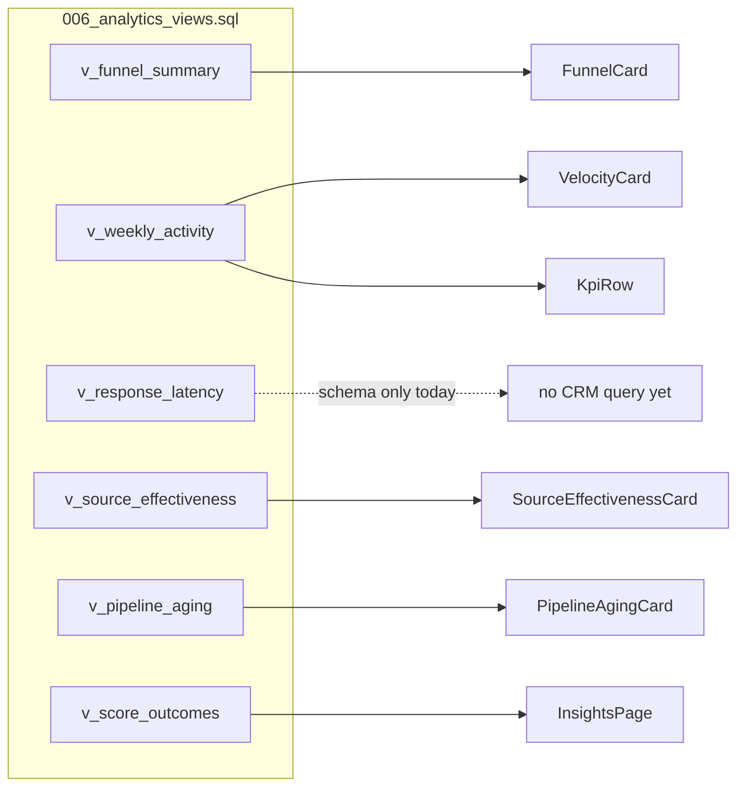

# JobTracker DB Relations (ERD)

```mermaid
erDiagram
    providers ||--o{ opportunities : provider_id
    organizations ||--o{ opportunities : organization_id

    providers ||--o{ automation_runs : provider_id
    artifacts ||--o{ automation_runs : report_artifact_id

    providers ||--o{ source_items : provider_id
    opportunities ||--o{ source_items : opportunity_id
    automation_runs ||--o{ source_items : automation_run_id
    artifacts ||--o{ source_items : artifact_id

    opportunities ||--o{ evaluations : opportunity_id
    automation_runs ||--o{ evaluations : automation_run_id
    providers ||--o{ evaluations : provider_id

    opportunities ||--o{ applications : opportunity_id
    organizations ||--o{ applications : organization_id
    providers ||--o{ applications : provider_id

    applications ||--o{ application_events : application_id

    organizations ||--o{ contacts : organization_id

    applications ||--o{ interviews : application_id
    organizations ||--o{ interviews : organization_id
    artifacts ||--o{ interviews : transcript_artifact_id

    interviews ||--o{ interview_contacts : interview_id
    contacts ||--o{ interview_contacts : contact_id

    applications ||--o{ communications : application_id
    organizations ||--o{ communications : organization_id
    contacts ||--o{ communications : contact_id
    artifacts ||--o{ communications : artifact_id

    opportunities ||--o{ opportunity_texts : opportunity_id

    opportunities ||--o{ documents : opportunity_id
    applications ||--o{ documents : application_id
    organizations ||--o{ documents : organization_id
    automation_runs ||--o{ documents : automation_run_id

    providers ||--o{ email_notifications : provider_id
    automation_runs ||--o{ email_notifications : automation_run_id
    automation_runs ||--o{ automation_run_events : automation_run_id

    providers ||--o{ legacy_import_rows : provider_id
    organizations ||--o{ legacy_import_rows : organization_id
    opportunities ||--o{ legacy_import_rows : opportunity_id
    applications ||--o{ legacy_import_rows : application_id
    source_items ||--o{ legacy_import_rows : source_item_id

    artifacts ||--o{ document_chunks : artifact_id
```

## Analytics views → CRM

Defined in `db/migrations/006_analytics_views.sql` (`security_invoker = true` so RLS still applies). Consumed by `crm/lib/analytics.ts` and dashboard/insights components.

| View | What it aggregates | CRM consumer |
|------|--------------------|--------------|
| `v_funnel_summary` | Opportunity → evaluation → applied → interviewing → offer counts and conversion % | `FunnelCard` via `fetchDashboardBundle` |
| `v_weekly_activity` | Weekly counts of opportunities, applications, interviews | `VelocityCard` and `KpiRow` (trend context) |
| `v_response_latency` | Days from `applied_at` to first reply / interview_invite / response event | Defined for analytics; **not** queried by the current CRM UI (response rate KPIs use `applications` + `application_events` directly) |
| `v_source_effectiveness` | Per-provider opportunities, applications, interviews, offers, app→interview % | `SourceEffectivenessCard` |
| `v_pipeline_aging` | Open applications with `days_in_stage` | `PipelineAgingCard` |
| `v_score_outcomes` | Evaluation score buckets with offer / resolved counts | Insights page (`InsightsPage` score distribution chart via `fetchInsightsBundle`) |

Dashboard wiring: `crm/components/dashboard/dashboard-page.tsx` loads the funnel, weekly, source, and aging views. Insights: `crm/components/insights/insights-page.tsx` loads `v_score_outcomes` plus table-level outcome/compensation queries.

## Notes

- Tables `artifacts` and `insights` use polymorphic links via `(related_type, related_id)` and therefore have no FK constraints for those fields.
- `jobtracker_schema_migrations` is operational metadata and intentionally isolated from domain tables.

