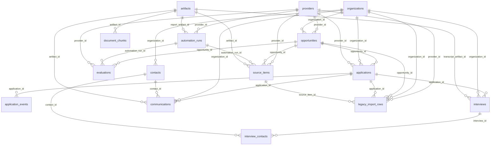

# JobTracker DB Relations (ERD)

## Notes

- Tables `artifacts` and `insights` use polymorphic links via `(related_type, related_id)` and therefore have no FK constraints for those fields.
- `jobtracker_schema_migrations` is operational metadata and intentionally isolated from domain tables.

