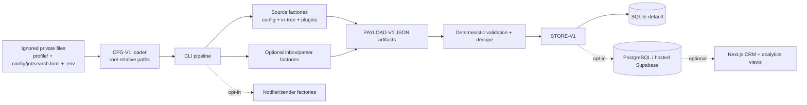
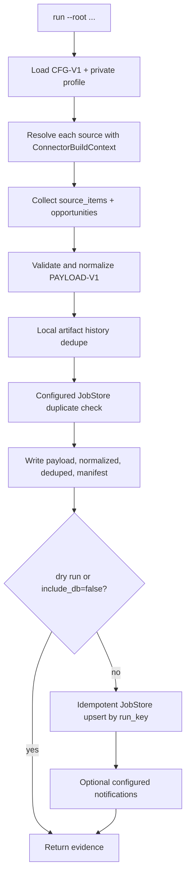
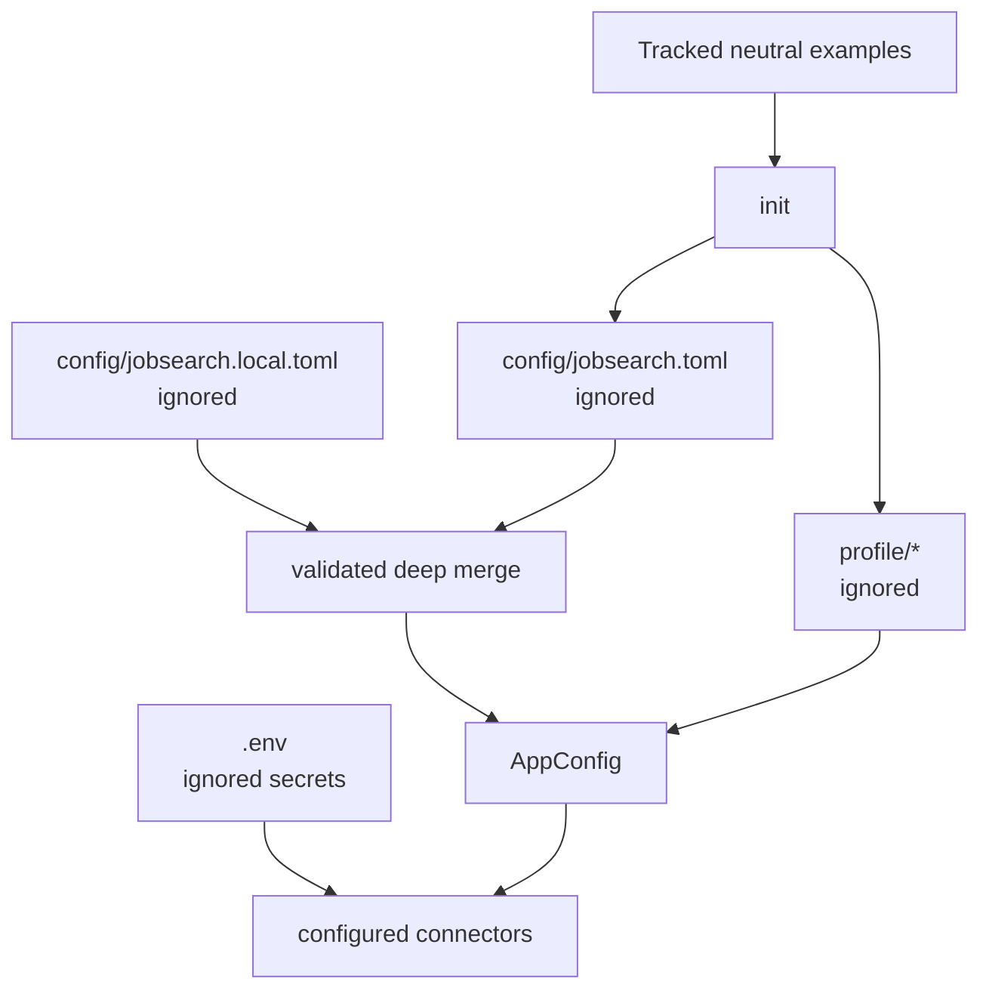

# Architecture

JobSearch is a local-first deterministic toolchain with optional service connectors,
notifications, PostgreSQL/Supabase persistence, and a Next.js CRM. The standard path
is Python plus SQLite and retained JSON artifacts; no Docker service is required.

## Runtime and boundaries

The CRM does not import Python and Python does not import CRM code. Secrets are read
from environment variables; config contains only non-secret connector settings.

## Pipeline execution

SQLite and PostgreSQL implement the same `upsert_run_payload`, `check_duplicates`,
and `export_application_summary` operations. JSON payloads are the recovery boundary:
`sync-pending-runs --target-store postgres` replays retained artifacts after a user
opts into PostgreSQL.

## Connector resolution

Every plugin factory receives `ConnectorBuildContext(root, slug, options)`. Legacy
zero-argument classes or instances are adapted with a deprecation warning through
the v0.2 compatibility window.

| Product | Built-in/config route | Plugin entry-point group |
| --- | --- | --- |
| Source | `[sources.foo] kind = "jsonld"` or an in-tree service | `jobtracker.sources` |
| Mail parser | Built-in parser or `kind = "rules"` | `jobtracker.mail.parsers` |
| Mail inbox | IMAP or maildir | `jobtracker.mail.inboxes` |
| Mail sender | SMTP | `jobtracker.mail.senders` |
| Store | SQLite, PostgreSQL, memory | `jobtracker.stores` |
| Notifier | Email/webhook/Slack/Telegram | `jobtracker.notifiers` |

See the [connector contract](contracts/connector-api-v1.md) and the installable
[fixture plugin](../examples/plugins/fixture-connectors/README.md).

## Config and private data

The machine-readable schemas under `schemas/` are authoritative. Configs without a
`schema_version` remain readable with a warning through v0.2; new configs use version
1. Doctor reports use DOCTOR-V1 and exit 0 for `ready`, 1 for `action_required`, and 2
for `error`.

See [configuration](configuration.md), [CLI reference](cli.md), and the
[documentation index](README.md).
