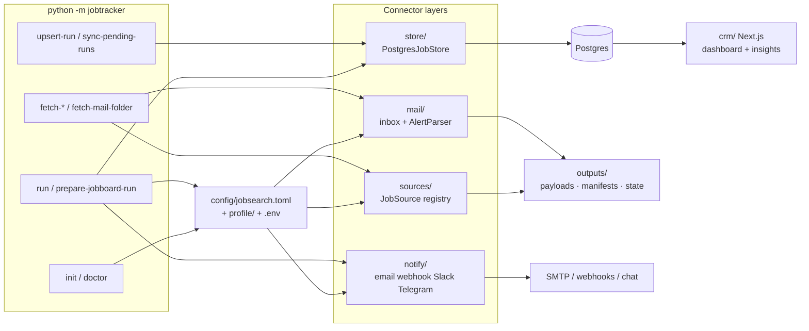
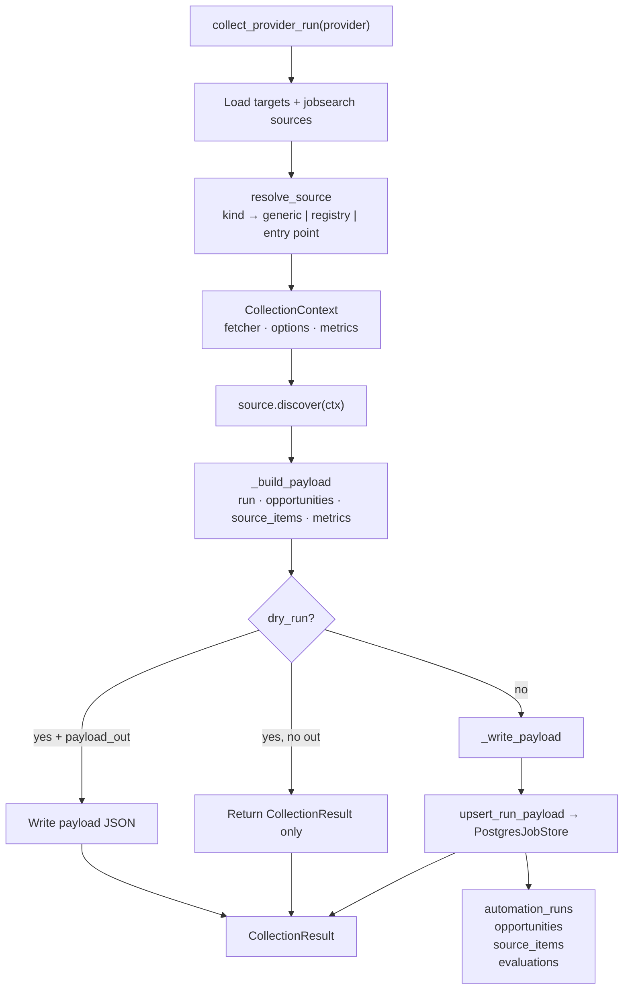
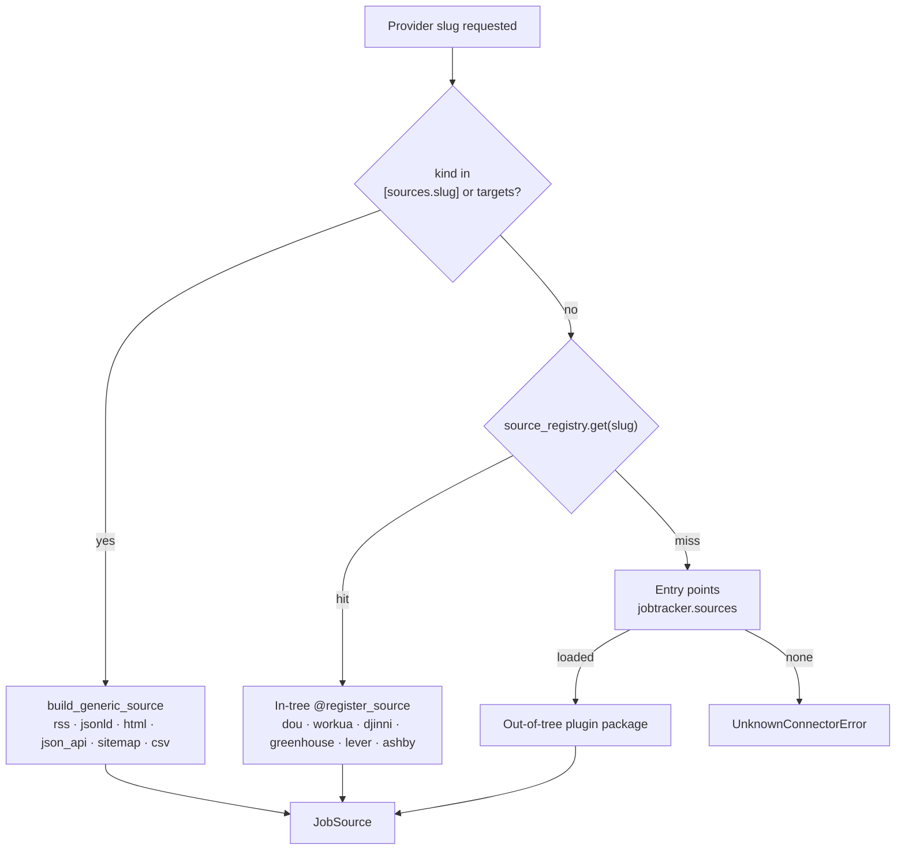
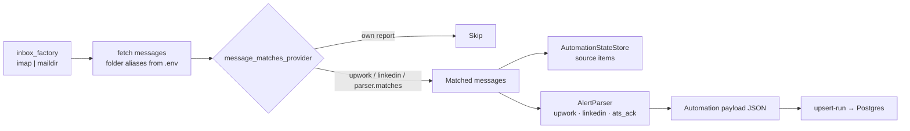
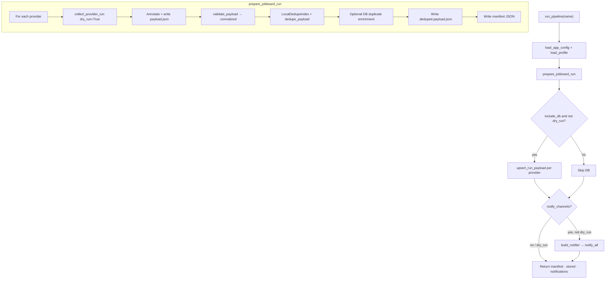
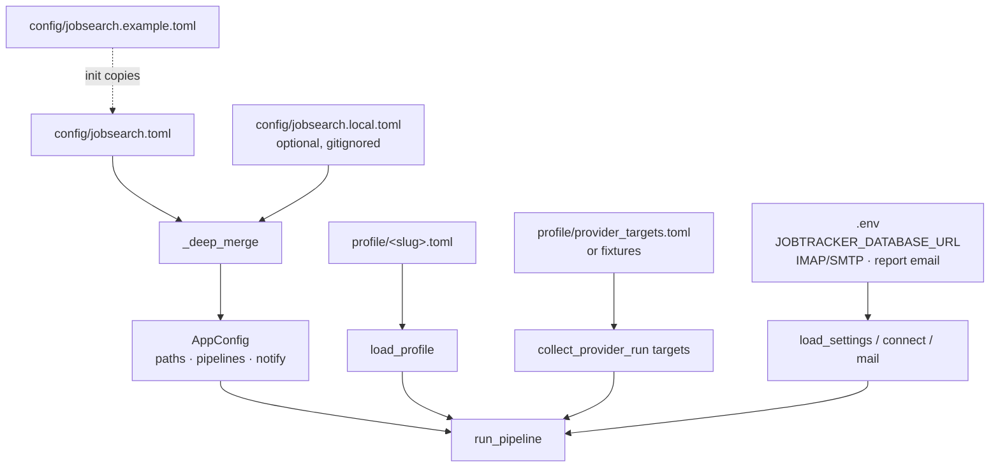

# Architecture

Hub overview of the JobSearch toolchain: CLI orchestration, pluggable connectors, Postgres persistence, and the Next.js CRM. Diagrams below are verified against `jobtracker/automation.py`, `sources/registry.py`, `mail/registry.py`, `app_config/loader.py`, `notify/registry.py`, and `jobboard_run.py`.

Related docs: [getting-started](getting-started.md) · [configuration](configuration.md) · [cli](cli.md) · [automation](automation.md) · [DB ERD](DB/ERD.md) · [payload contract](DB/AUTOMATION_PAYLOAD_CONTRACT.md)

---

## a. System overview

CLI loads layered config, runs discovery or mail pipelines through connector registries, upserts into Postgres, notifies configured channels, and the CRM reads analytics views.

---

## b. Discovery data flow

`collect_provider_run` resolves a source, calls `discover`, builds a contract payload, optionally writes JSON, and upserts when not dry-run.

---

## c. Connector registry and extension paths

Three ways to add a source (same pattern for mail parsers and notifiers via their entry-point groups).

| Path | Mechanism | Example |
|------|-----------|---------|
| Config only | `[sources.foo] kind = "jsonld"` | Generic boards with structured markup |
| In-tree service | Class under `sources/services/` + `@register_source` | DOU, Greenhouse |
| Plugin | `[project.entry-points."jobtracker.sources"]` | Private connector package |

Mail parsers use `jobtracker.mail.parsers`; notifiers use `jobtracker.notifiers`; stores follow the same registry idea under `jobtracker/store/`.

---

## d. Mail pipeline

IMAP (or maildir) fetch → provider filter → parser → automation payload.

CLI surface: `discover-mail-folders` → `fetch-mail-folder` → `parse-upwork-alerts` (and playbook-driven parsers for other providers) → `upsert-run` / `send-report-email`.

---

## e. Pipeline execution

`run_pipeline` loads config and profile, delegates prepare/dedupe to `prepare_jobboard_run`, then optionally upserts and notifies.

Manifest lists deterministic steps completed and LLM/agent steps remaining (evaluate, report, email) for playbook follow-up.

---

## f. Config layering

Secrets stay in `.env`; non-secret automation settings merge from TOML overlays and profile files.

| Layer | Tracked | Role |
|-------|---------|------|
| `config/jobsearch.toml` | Yes (user-created) | Pipelines, notify channels, paths |
| `config/jobsearch.local.toml` | No | Machine-specific overrides |
| `profile/*.toml` | No | Search profile, targets path, report templates |
| `.env` | No | DB URL, mail passwords, API keys |

See [configuration.md](configuration.md) for variable tables and TOML shape.
