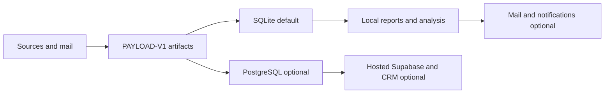

# JobSearch Toolchain

A local-first, extensible toolkit for discovering opportunities, normalizing and deduplicating them, tracking search activity, and producing analysis artifacts. Python, SQLite, and local files are the standard path. PostgreSQL, hosted Supabase, mail, notifications, scheduling, and the Next.js CRM are optional layers.

## Quick start

Supported standard environments are macOS and Linux with Python 3.10 or newer. Docker is not required.

```bash
git clone https://github.com/the-dmytro/jobsearch-toolchain.git
cd jobsearch-toolchain
python3 -m venv .venv
.venv/bin/pip install -e .

# Verify deterministic collectors without personal data or network access.
.venv/bin/python -m jobtracker benchmark-sources \
  --providers example_jsonld \
  --fixture-dir jobtracker/fixtures/provider_fetch

# Create ignored private configuration and profile files.
.venv/bin/python -m jobtracker init
.venv/bin/python -m jobtracker doctor --skip-network
```

`doctor` reports profile placeholders as actions until the private profile is filled. An agent can guide that process using [the kickstart protocol](Docs/onboarding/AGENT_KICKSTART.md); the same steps are available in the [documentation index](Docs/README.md).

## Product layers



- Deterministic collectors: RSS, JSON-LD, HTML, JSON API, and service adapters.
- Connector factories and plugin entry points for sources, mail, stores, and notifiers.
- Idempotent local SQLite persistence plus replayable JSON payload artifacts.
- PostgreSQL migrations and analytics views, with hosted Supabase supported as a PostgreSQL provider.
- Optional Next.js CRM requiring Node.js 20 and hosted Supabase.

## Private data boundary

The generated `config/jobsearch.toml`, all filled `profile/` files, `.env`, `outputs/`, local databases, and onboarding state are ignored. Public templates live only under `profile/templates/generic/`. Never force-add private files to the public repository.

## Extending and contributing

Start with [connector contracts](Docs/contracts/README.md) and [connector guides](Docs/connectors/README.md). Install out-of-tree plugins from a local path or Git URL; no PyPI publication is implied for v0.2.0. Reusable changes should be proposed through a public branch and pull request using [CONTRIBUTING.md](CONTRIBUTING.md).

## License

MIT — see [LICENSE](LICENSE).
