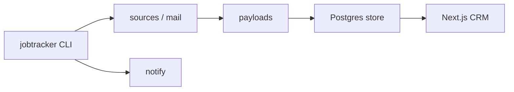

# JobSearch Toolchain

Open-source job-search automation: discover opportunities from job boards and email alerts, evaluate them against your profile, track applications in a database, and view analytics in a CRM dashboard.

## Features

- **Pluggable connectors** — general-purpose (RSS, JSON-LD, HTML, JSON API) and service-specific (DOU, Work.ua, Djinni, Greenhouse, Lever, Ashby, Upwork, LinkedIn)
- **Mail pipeline** — IMAP fetch, deterministic parsers, SMTP reports
- **Postgres storage** — plain PostgreSQL (Supabase is one supported host)
- **Next.js CRM** — dashboard with funnel, velocity, source effectiveness, pipeline aging
- **Agent-friendly docs** — playbooks and `AGENTS.md` for AI-assisted workflows



Architecture diagrams (discovery, registries, mail, pipelines, config): [Docs/architecture.md](Docs/architecture.md).

## Quick start

```bash
git clone https://github.com/the-dmytro/jobsearch-toolchain.git
cd jobsearch-toolchain
python3 -m venv .venv
.venv/bin/pip install -r requirements.txt
.venv/bin/pip install -e .

# Scaffold your config and profile
.venv/bin/python -m jobtracker init

# Validate setup (offline)
.venv/bin/python -m jobtracker doctor --skip-network

# Dry-run collectors with bundled fixtures (no network)
.venv/bin/python -m jobtracker fetch-dou --dry-run --fixture-dir jobtracker/fixtures/provider_fetch
.venv/bin/python -m jobtracker benchmark-sources --providers dou,workua,djinni,greenhouse
```

## Configuration

1. Copy `.env.example` → `.env` and fill database / mail credentials
2. Edit `config/jobsearch.toml` (created by `init`) — enable connectors, set report email
3. Fill `profile/` from `profile/templates/` — your preferences, CV source, project banks
4. Apply migrations: `.venv/bin/python -m jobtracker migrate`

<<<<<<< HEAD
See [Docs/getting-started.md](Docs/getting-started.md) and [Docs/configuration.md](Docs/configuration.md).
=======
See [Docs/getting-started.md](Docs/getting-started.md), [Docs/configuration.md](Docs/configuration.md), and [Docs/architecture.md](Docs/architecture.md).
>>>>>>> 185c4ac (Add architecture diagrams, CLI map, and analytics view docs)

## CRM

```bash
cd crm
cp ../.env.example .env.local   # or symlink
npm install
npm run dev
```

Set `CRM_OWNER_EMAIL` to your Supabase Auth email. See [crm/README.md](crm/README.md).

## Project layout

```
config/                 User configuration (TOML)
profile/                Your personal data (gitignored)
profile/templates/      Scaffold templates with {{PLACEHOLDER}} tokens
jobtracker/             Python CLI and connector framework
  core/                 Models, registry, protocols
  sources/              Job board collectors
  mail/                 IMAP/SMTP and email parsers
  store/                Database and artifact backends
  notify/               Report delivery (email, webhook, Slack, Telegram)
crm/                    Next.js CRM dashboard
db/migrations/          PostgreSQL schema
Docs/                   Architecture, CLI map, configuration
Docs/DB/                Schema docs and payload contract
Docs/playbooks/         Automation instructions for agents
```

## Automation

```bash
# Run a configured pipeline
.venv/bin/python -m jobtracker run jobboards --dry-run

# Manual single-source fetch
.venv/bin/python -m jobtracker fetch-greenhouse-jobs --dry-run
```

Cron, launchd, and GitHub Actions examples: [examples/automation/](examples/automation/).

## Extending

| Approach | When |
|----------|------|
| Config only (`kind = "jsonld"` in TOML) | Standard job board with structured data |
| In-tree service class | Named provider with custom parsing |
| Out-of-tree plugin (entry points) | Private connector without forking |

Guides: [Docs/connectors/](Docs/connectors/).

## License

MIT — see [LICENSE](LICENSE).
